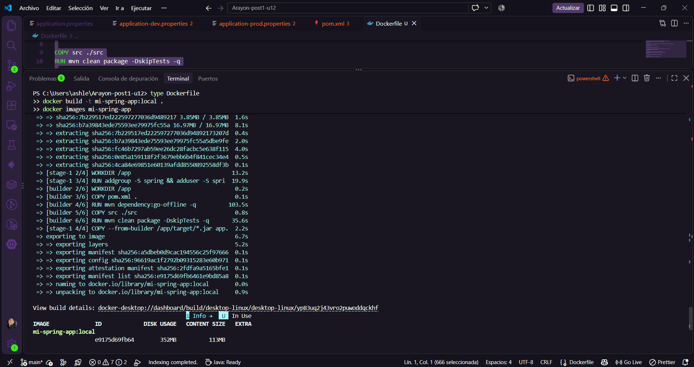
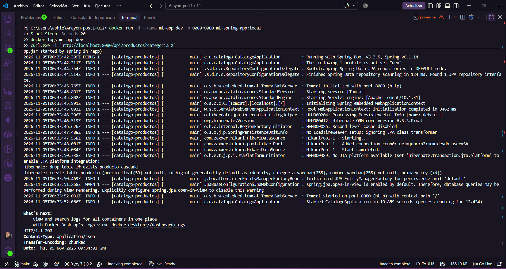
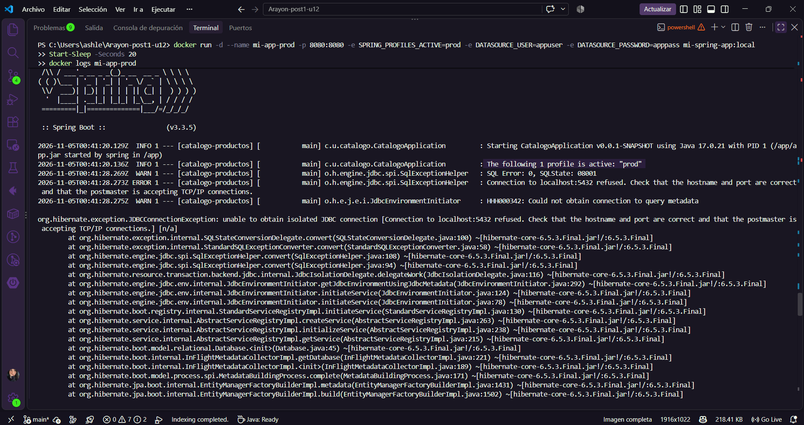
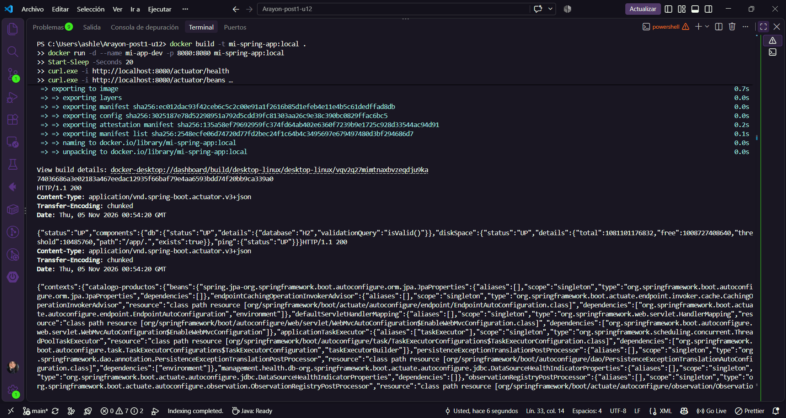
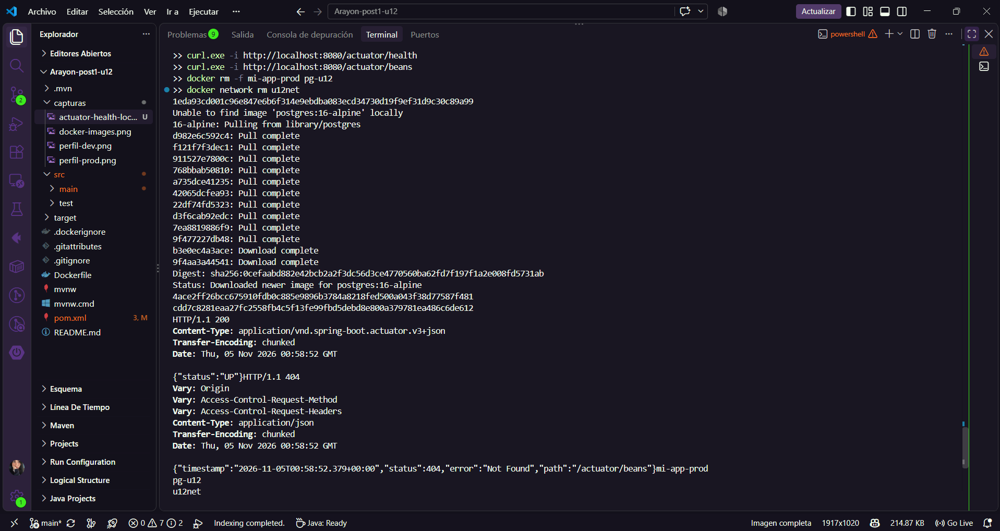
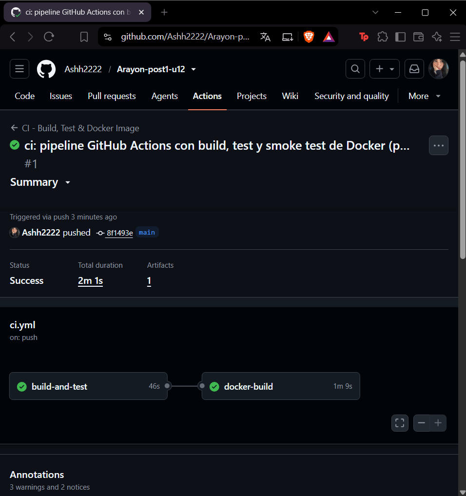
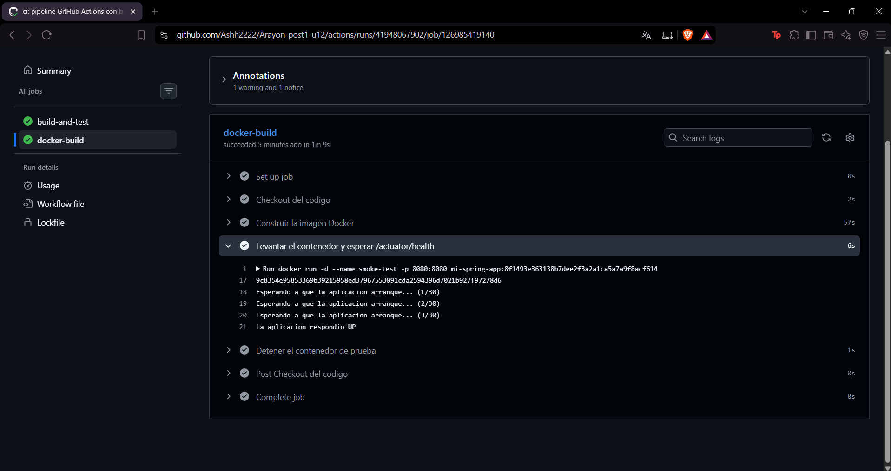
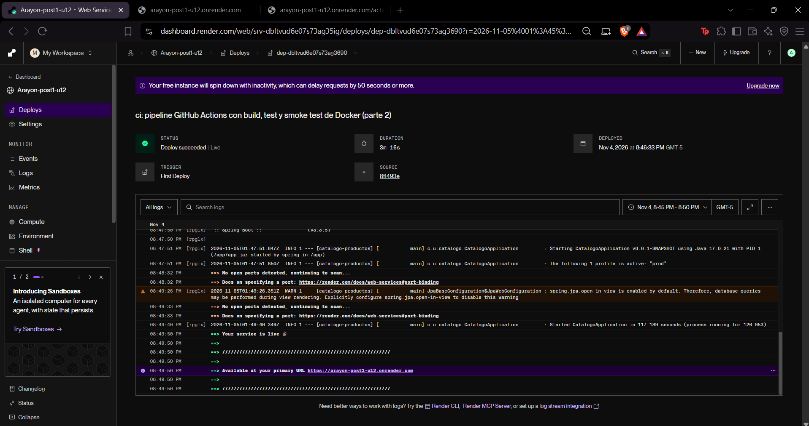
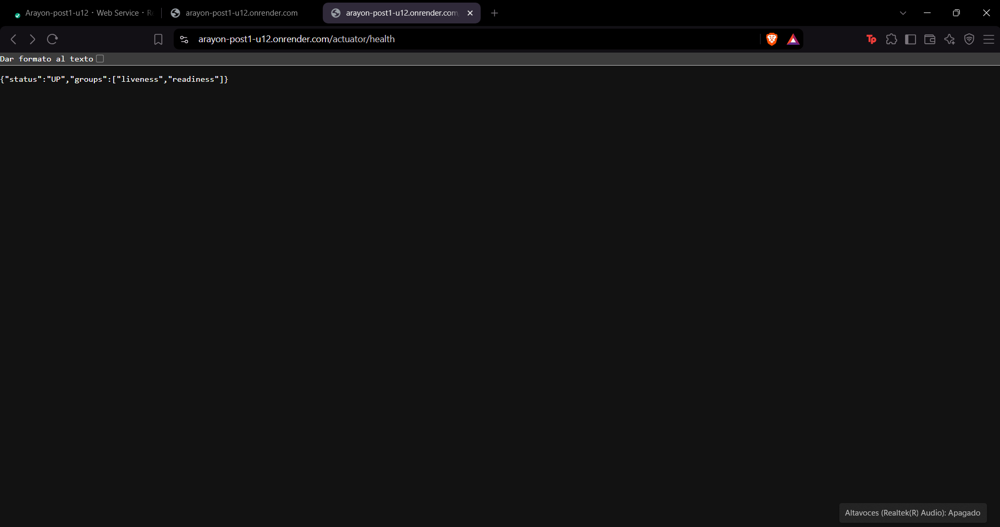
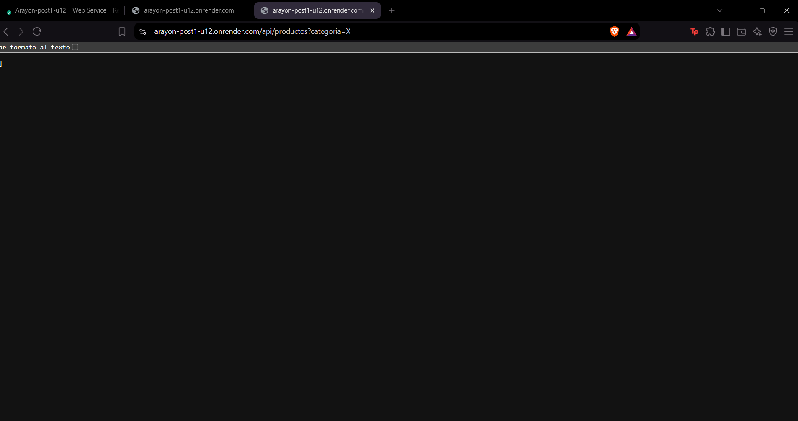

# Post-contenido — Unidad 12: Despliegue y CI/CD

Laboratorio de Programación Web (Séptimo Semestre). Aplicación Spring Boot (catálogo de
productos de la Unidad 10) dockerizada con perfiles dev/prod, con un pipeline de GitHub Actions
y monitoreo con Actuator, desplegada en Render.

## Parte 1: Dockerización con perfiles y variables de entorno

El Dockerfile compila con Maven (`maven:3.9-eclipse-temurin-17-alpine`) y ejecuta el JAR en
`eclipse-temurin:17-jre-alpine` con usuario no root. La configuración sensible se externaliza
con placeholders `${VAR:default}`: sin variables arranca con el perfil `dev` (H2 en memoria);
con `SPRING_PROFILES_ACTIVE=prod` y `DATASOURCE_URL`, `DATASOURCE_USER`, `DATASOURCE_PASSWORD`
usa PostgreSQL.

`DISK USAGE` (~352 MB) incluye capas descomprimidas; el tamaño de contenido es ~113 MB.

Sin variables de entorno: perfil `dev`.

Con `SPRING_PROFILES_ACTIVE=prod`: perfil `prod`.

## Parte 2: Pipeline CI/CD y monitoreo con Actuator

Actuator expone todos los endpoints en `dev` y solo `health` e `info` en `prod`.

En dev, `/actuator/health` responde UP.

En prod, `health` responde UP y `/actuator/beans` responde 404.

El workflow `.github/workflows/ci.yml` se ejecuta en cada push a `main` con dos jobs:
1. **build-and-test:** JDK 17 con caché Maven, `mvn clean verify` y publica el reporte de pruebas como artefacto.
2. **docker-build** (`needs: build-and-test`): construye la imagen, levanta el contenedor en el runner y hace un smoke test contra `/actuator/health` (hasta 30 intentos). No publica la imagen en ningún registro. Limpia el contenedor con `if: always()`.

Ejecución con ambos jobs en verde.

El smoke test confirma que la imagen recién construida responde UP.

## Despliegue (paso final manual)

Desplegado en **Render** (plan gratuito) a partir del mismo Dockerfile, con una base PostgreSQL de
Render. Variables configuradas en el panel: `SPRING_PROFILES_ACTIVE=prod`, `DATASOURCE_URL`
(con prefijo `jdbc:postgresql://`), `DATASOURCE_USER` y `DATASOURCE_PASSWORD`.

- URL: https://arayon-post1-u12.onrender.com
- Health: https://arayon-post1-u12.onrender.com/actuator/health

Servicio activo en Render (las capturas conservan el prefijo `railway-` del nombre original, pero la plataforma usada es Render).

`/actuator/health` responde UP desde la URL pública.

`/api/productos?categoria=X` responde `[]`: la app conecta a PostgreSQL con el perfil `prod`.

## Decisiones de diseño

**Parte 1**
1. **Placeholders con valor por defecto en vez de estrictos:** la app arranca sin fricción en local y en CI; los valores reales se inyectan en producción. La contraseña de producción no tiene default utilizable.
2. **`application-dev.properties` y `application-prod.properties` separados:** hace explícito qué configuración corresponde a cada ambiente y evita editar producción por error.
3. **JRE Alpine y no distroless:** imagen pequeña sin perder `docker exec` para depurar.

**Parte 2**
1. **Test de contexto con perfil dev:** el job de CI valida algo real antes de construir la imagen.
2. **`docker-build` construye y verifica, pero no publica la imagen:** evita exigir cuentas y Secrets externos; el smoke test valida lo esencial (que la imagen arranca y expone el monitoreo).
3. **Actuator diferenciado por perfil:** en producción no se exponen endpoints sensibles como `beans` o `env`.

## Decisiones propias (ajustes al material base)
- **Etapa de build con imagen de Maven:** `eclipse-temurin:*-jdk-alpine` no incluye `mvn`, así que el build del enunciado fallaría.
- **Java 17** en Dockerfile y workflow, igual que el `pom.xml`.
- **Driver PostgreSQL** como `runtime`, necesario para el perfil `prod`.
- **`ddl-auto=update` en prod:** `validate` falla con una base vacía y no hay Flyway en el alcance.
- **Smoke test de 30 intentos** (el enunciado traía 15) y `docker logs` si falla.
- **Reutilización de `CatalogoApplicationTests`** con `@ActiveProfiles("dev")`, sin test duplicado.
- **`DATASOURCE_URL` con prefijo `jdbc:`:** Render entrega la URL como `postgresql://`, que JDBC no acepta.
- **Render en vez de Railway:** plan gratuito sin tarjeta.
- **Secretos fuera del repositorio:** la contraseña de la base solo existe como variable de entorno en Render.

## Cómo compilar y ejecutar
1. Construir la imagen: `docker build -t mi-spring-app:local .`
2. Perfil dev: `docker run -p 8080:8080 mi-spring-app:local`
3. Perfil prod: `docker run -p 8080:8080 -e SPRING_PROFILES_ACTIVE=prod -e DATASOURCE_URL=jdbc:postgresql://HOST:5432/BASE -e DATASOURCE_USER=... -e DATASOURCE_PASSWORD=... mi-spring-app:local`
4. Verificar el estado: `curl http://localhost:8080/actuator/health`
5. Consultar el pipeline en la pestaña **Actions** del repositorio.